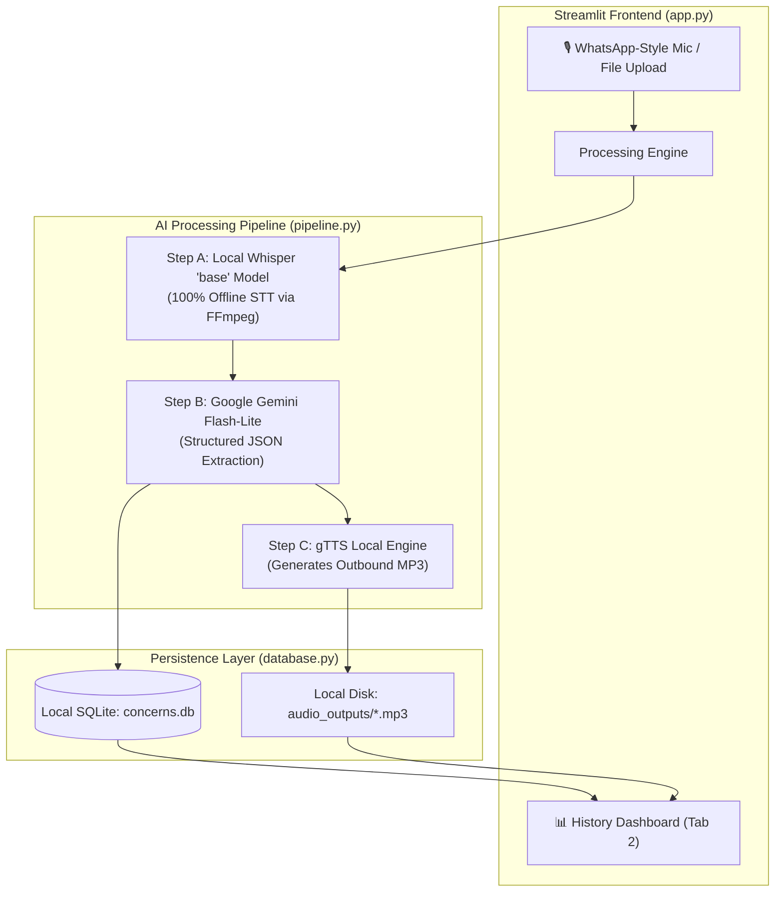

# 🎙️ Customer Concern Analyzer Dashboard

A **100% Free, Production-Ready Customer Concern Analyzer** built with Streamlit for Windows. It captures client voice recordings (browser mic or file upload), transcribes audio locally using OpenAI Whisper, structures business intelligence with Google Gemini Flash (Free Tier), synthesizes voice responses using gTTS, and persists historical interactions in a local SQLite database.

---

## 🏗️ Architecture & Component Overview



### 100% Free & Local Tech Stack:
- **UI Framework:** Streamlit (`streamlit`)
- **Speech-to-Text:** OpenAI Whisper (`openai-whisper`, running 100% locally and offline on CPU/GPU with the `base` model)
- **Text Engine:** Google Gemini Flash-Lite / Flash via the official `google-genai` SDK (Free Tier API Key from Google AI Studio)
- **Voice Synthesis (TTS):** gTTS (Google Text-to-Speech open-source local Python library)
- **Database:** Local SQLite (`sqlite3`, file `concerns.db`)
- **Audio Capture:** WhatsApp-style browser recording via `audio-recorder-streamlit` + file uploader fallback

---

## 🪟 Windows Setup Instructions

### 1. Install FFmpeg on Windows (Mandatory for Whisper)
OpenAI Whisper requires **FFmpeg** to decode and process audio binaries. To install FFmpeg on Windows and add it to your system PATH:

#### Option A: Using Windows Package Manager (`winget`) - Recommended
Open **Windows PowerShell** as Administrator and run:
```powershell
winget install Gyan.FFmpeg
```

#### Option B: Using Chocolatey (`choco`)
```powershell
choco install ffmpeg-full -y
```

> **Verification:** Close and reopen PowerShell, then run:
> ```powershell
> ffmpeg -version
> ```
> If the command prints the version details, FFmpeg is successfully installed and in your PATH.

---

### 2. Clone / Navigate to the Project

```powershell
cd C:\Users\Dell\.gemini\antigravity\scratch\customer-concern-analyzer
```

---

### 3. Create a Python Virtual Environment

```powershell
python -m venv venv
.\venv\Scripts\activate
```

---

### 4. Install Dependencies

```powershell
pip install -r requirements.txt
```

> **PyTorch Note for Windows:**  
> If you have an NVIDIA GPU and want CUDA acceleration for Whisper:
> ```powershell
> pip install torch torchaudio --index-url https://download.pytorch.org/whl/cu121
> ```
> Otherwise, Whisper will automatically run on the CPU with `fp16=False` without issues.

---

### 5. Configure Free Google Gemini API Key

1. Go to [Google AI Studio](https://aistudio.google.com/app/apikey) and generate a **free developer API key** (no credit card required).
2. Copy the template `.env.example` to `.env`:
   ```powershell
   Copy-Item .env.example .env
   ```
3. Edit `.env` and set your key:
   ```ini
   GEMINI_API_KEY=your_actual_gemini_api_key_here
   GEMINI_MODEL=gemini-2.5-flash
   ```
   *(You can also paste the API key directly into the sidebar in the Streamlit UI).*

---

## 🚀 Running the Dashboard

Launch the Streamlit app:
```powershell
streamlit run app.py
```

The application will open automatically in your browser at `http://localhost:8501`.

---

## 📁 Project Structure

```
customer-concern-analyzer/
├── app.py               # Streamlit application UI (Tab 1: Capture & AI, Tab 2: History Dashboard)
├── pipeline.py          # AI Orchestration (Whisper STT -> Gemini Structured JSON -> gTTS)
├── database.py          # SQLite database connection, schema init, and CRUD operations
├── requirements.txt     # Python package requirements
├── .env.example         # Environment variables template
├── concerns.db          # Auto-created SQLite database file
├── audio_outputs/       # Directory storing synthesized outbound MP3 voice messages
└── README.md            # Complete documentation and setup guide
```

---

## 📋 Features Walkthrough

### 🎙️ Tab 1: New Voice Entry
- **WhatsApp-Style Microphone:** Tap the mic button to start recording; tap again to stop.
- **Audio File Upload:** Alternative tab to upload `.wav`, `.mp3`, `.m4a`, or `.ogg` files.
- **Live Status Tracker:** Step-by-step progress indicator during transcription, Gemini analysis, and voice synthesis.
- **Structured Intelligence Cards:**
  - Client organization name identification
  - Color-coded urgency badge (**High**, **Medium**, **Low**)
  - Bullet-point breakdown of customer pain points
  - Spoken-style empathetic drafted response
  - In-browser playback and MP3 download of the synthesized voice message.

### 📊 Tab 2: History & Analytics Dashboard
- **Key Metrics:** Total customer cases, high/medium/low urgency breakdown.
- **Search & Filters:** Real-time filtering by organization name, keywords, or urgency level.
- **Historical Audio Player:** Streamlit audio players embedded in each past case card to replay previously synthesized voice replies.
- **Data Cleanup:** Single-click deletion of past records and associated MP3 files.
